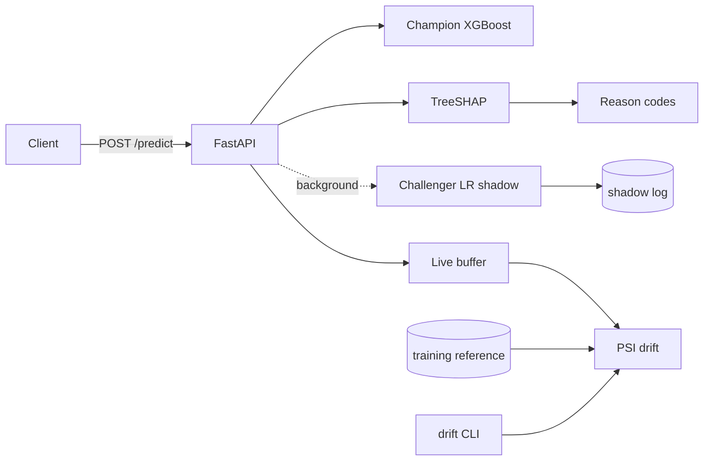

# Risk Scoring Service: credit-default API with regulator-style decisioning

XGBoost credit-default scoring behind a FastAPI service, built around what a model-risk reviewer asks for: **adverse-action reason codes** derived from SHAP for every decline, a **model card**, **PSI drift monitoring** (API endpoints and a CSV CLI) against the training reference, and **champion/challenger shadow scoring** that logs a challenger's score without touching the decision. Free by default (Docker or a Hugging Face Space); the AWS deploy path is kept as an option.



Full design (requirements, sequence diagram, failure modes, ADRs, cost table): [docs/DESIGN.md](docs/DESIGN.md). Model card: [docs/MODEL_CARD.md](docs/MODEL_CARD.md).

## Quickstart

```bash
docker compose up --build          # trains on UCI data during the build, serves on :8000
curl -s localhost:8000/predict -H 'content-type: application/json' -d @examples/applicant_high_risk.json
docker compose exec api python -m src.monitoring.cli drift demo/drifted.csv
```

Without Docker: `make setup-dev && make train && make run-api`, then open `http://localhost:8000`.

## Unique features

**Adverse-action reasons.** A declined `/predict` returns e.g. `{"code": "R01", "reason": "Delinquent or revolving repayment status in the most recent month", "contribution": ...}`, built from the strongest risk-raising SHAP contributors, merged by reason and capped at `REASON_CODE_COUNT`. `sex`, `age`, `marriage` and `education` are never given as reasons.

**Drift monitoring.** `POST /monitoring/drift`, `GET /monitoring/live` (last 1000 predictions) and
```bash
python -m src.monitoring.cli drift batch.csv --fail-on significant   # exit code 2 on significant drift
```
report PSI per feature and for the score distribution (stable < 0.10, moderate < 0.25, significant above). `make demo-drift` builds a stable and a deliberately shifted batch by resampling the training data. CI runs the CLI on both inside the built image and prints the reports in the job summary.

**Shadow scoring.** The logistic-regression baseline scores every request in a background task and appends to `logs/shadow_scores.jsonl`; `GET /monitoring/shadow` reports decision agreement and mean probability gap.

## Model performance

Reproduced by `make train` (UCI Default of Credit Card Clients, 30,000 rows, 80/20 stratified split, seed 42):

| Model | ROC-AUC | Accuracy | Precision | Recall |
|-------|---------|----------|-----------|--------|
| **XGBoost** | **0.774** | 0.817 | 0.660 | 0.359 |
| Logistic Regression (baseline / challenger) | 0.708 | 0.808 | - | - |

About 22% of rows are defaults, so always predicting "no default" scores about 78% accuracy; ROC-AUC is the headline metric. Metrics for each CI build are printed in the CI job summary.

## Deployment

- **Default (free)**: Docker (`docker compose up`) or a Hugging Face Docker Space. Set repo variable `HF_SPACE` and secret `HF_TOKEN`; `.github/workflows/deploy-hf.yml` then syncs the repo to the Space on every push to `main` (it skips silently when they are unset).
- **Optional (AWS)**: Lambda via SAM or EC2 + Caddy, kept for reference; see below and [docs/DEPLOY_GUIDE.md](docs/DEPLOY_GUIDE.md). Free-tier terms are time-limited.

Configuration is environment-only; see `.env.example`.

## Limitations

- Single-country, single-year dataset; no out-of-time validation; probabilities are uncalibrated.
- Protected attributes remain model inputs; excluding them from reason codes is not a fairness audit.
- The challenger is the baseline logistic regression, not a retrained candidate; the live buffer and shadow counters are per process.
- The Docker build needs network access to the UCI repository (or `--build-arg USE_SYNTHETIC_DATA=true`, which trains on random noise and says so in the model card).

## AWS Deployment (optional)

### Mode A: Serverless (Lambda)
Ensure you have `aws-cli` and `sam-cli` installed, and run `make train` first (the Lambda package ships `models/`).
```bash
./infra/deploy_lambda.sh
```

### Mode B: EC2 (Docker)
Follow the detailed [Deployment Guide](docs/DEPLOY_GUIDE.md).

**Key Features of this Deployment:**
- **Low cost**: fits a `t2.micro`/`t3.micro` while the account's free-tier window lasts; check current pricing.
- **HTTPS Enabled**: Uses **Caddy** for automatic SSL termination (Let's Encrypt).
- **Dynamic DNS**: Integrates with **DuckDNS** for a free custom domain.
- **Containerized**: Orchestrated via `docker-compose` for stability.

**Quick Summary:**
1. Launch a `t2.micro` EC2 instance.
2. Transfer code via `scp`.
3. Set your DuckDNS domain: `export DOMAIN_NAME=yourapp.duckdns.org`
4. Run `docker-compose -f docker-compose.aws.yml up -d --build` to start the secure stack.

## Monitoring & Logs
- **Lambda**: View CloudWatch Logs groups `/aws/lambda/RiskScoringFunction`.
- **EC2**: View local container logs via `docker-compose logs -f`.
- **API**: JSON logs with a request id and latency per request (`X-Request-ID` response header).

## Cost notes (AWS)
- **Lambda**: 400,000 GB-seconds per month free. Use nominal memory (512MB).
- **EC2**: 750 hours/month of t2.micro or t3.micro.
- **S3**: 5GB storage free. Clean up artifacts periodically.
