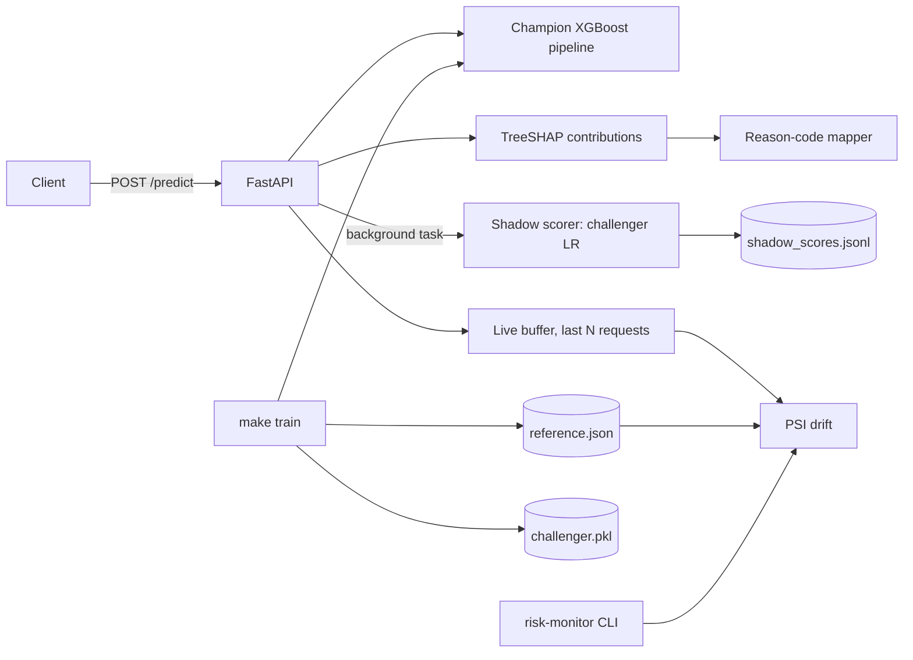
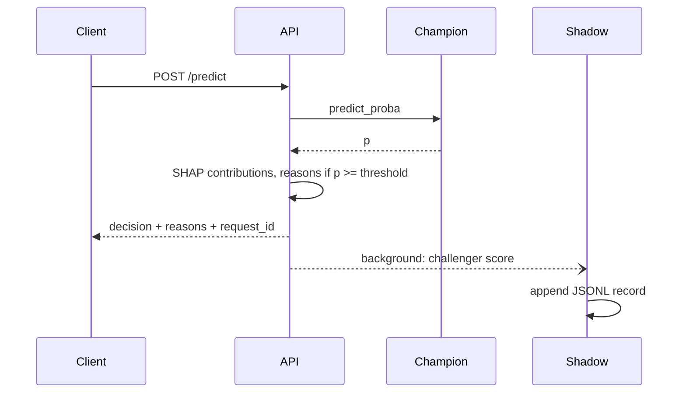

# Design: Risk Scoring Service

## 1. Problem
Score credit-card default risk and make each decision defensible: a declined applicant gets
the principal reasons, the model's inputs are monitored for drift, and a candidate model can
be evaluated on live traffic without affecting decisions.

## 2. Requirements
**Functional**
- `POST /predict`: probability, decision at a configurable threshold, SHAP contributions, and adverse-action reason codes on decline.
- `POST /monitoring/drift`, `GET /monitoring/live`, and a CLI: PSI per feature plus score-distribution PSI against the training reference.
- Champion/challenger shadow scoring: the challenger score is logged, never returned or used.
- `GET /model-card`, `/healthz`, `/readyz`.

**Non-functional**
- Free to run (Docker locally, Hugging Face Space free tier). AWS path optional.
- Stateless request path; p50 latency dominated by one XGBoost predict plus one TreeSHAP call (not benchmarked here).
- Structured JSON logs with a request id; config only through environment variables; non-root container.

## 3. Architecture

## 4. Data model
- `models/model.pkl`, `models/challenger.pkl`: scikit-learn pipelines (preprocessor + classifier).
- `models/reference.json`: per numeric feature, quantile `edges` and `expected` bin proportions from the training split, plus the champion score distribution (`__score__`).
- `models/model_card.json`: generated from `reports/metrics.json` at train time.
- `logs/shadow_scores.jsonl`: `request_id, champion_probability, challenger_probability, champion_decision, challenger_decision, agree`.

## 5. API contract
| Endpoint | Purpose |
|---|---|
| `POST /predict` | 23 UCI-style fields in; `default_probability, decision, threshold, adverse_action_reasons[], shap_values, request_id` out |
| `POST /monitoring/drift` | `{rows:[...]}` in; PSI report out (503 if reference missing) |
| `GET /monitoring/live` | PSI of the rolling window of recent predictions (404 if empty) |
| `GET /monitoring/shadow` | challenger agreement and mean absolute probability gap |
| `GET /model-card`, `/healthz`, `/readyz`, `/docs` | metadata and probes |

## 6. Reason codes
Top positive log-odds contributors (features raising default risk) are mapped to codes `R01..R05` and merged when several features share a reason. `sex, age, marriage, education` are never reported as reasons. This is a design choice for the demo, not legal advice; the model still consumes those inputs (see model card).

## 7. Drift
PSI = sum((actual - expected) * ln(actual / expected)) over 10 quantile bins fixed at training time. Conventional thresholds: < 0.10 stable, 0.10-0.25 moderate, >= 0.25 significant. Batches under `MIN_DRIFT_ROWS` get a warning because PSI is noisy on small samples. The CLI exits 2 with `--fail-on significant`, so it can gate a pipeline.

## 8. Scaling path
The request path is stateless; run N replicas behind a load balancer. Replace the in-memory live buffer and per-process shadow counters with a shared store (Redis or a stream), and ship shadow logs to object storage for offline challenger analysis. Run the CLI on a schedule over a daily extract.

## 9. Failure modes
| Failure | Mitigation |
|---|---|
| Model file missing | Process stays up; `/healthz` reports degraded, `/readyz` and `/predict` return 503 |
| SHAP computation fails | Decision still returned; explanation fields empty, error logged |
| Challenger fails or disk full | Swallowed and logged inside a background task; the decision is unaffected |
| Reference missing | Monitoring endpoints return 503; scoring unaffected |
| Drifted inputs | Surfaced via PSI; no automatic retraining (see trade-offs) |

## 10. Security and privacy
Non-root container, no secrets in the repo (`.env.example` only), inputs validated by Pydantic, CodeQL and Dependabot enabled. The live buffer and shadow log hold applicant features and scores in memory/on disk: treat them as personal data in a real deployment. The model uses protected attributes as inputs; no fairness audit was done.

## 11. Decisions
- **ADR-1 Train inside the Docker build.** Model binaries are not committed; the image reproduces them from public data. Cost: build needs network access to the UCI repository.
- **ADR-2 Logistic regression as challenger.** Already trained as the baseline, cheap, and a genuinely different model family. A real challenger would be a retrained GBM.
- **ADR-3 Background-task shadowing.** Guarantees the response is built before the challenger runs. Trade-off: shadow records can be lost on a crash.
- **ADR-4 PSI over KS/Wasserstein.** Familiar to credit-risk teams and has standard thresholds; binning loses within-bin shifts.
- **ADR-5 Hugging Face Space (Docker) as default host.** Free, no card; sleeps when idle and has ephemeral disk.

## 12. Cost (free tier)
| Item | Service | Cost |
|---|---|---|
| CI, CodeQL, container registry | GitHub Actions / GHCR (public repo) | $0 |
| Demo hosting | Hugging Face Space, CPU basic | $0 (sleeps when idle) |
| Local | Docker Compose | $0 |
| Optional AWS (Lambda/EC2) | AWS | free tier is time-limited; not required |
